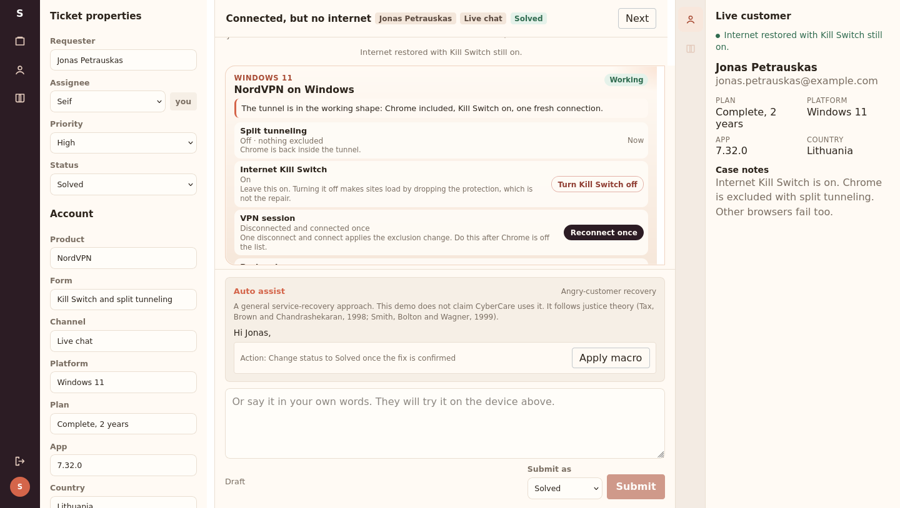
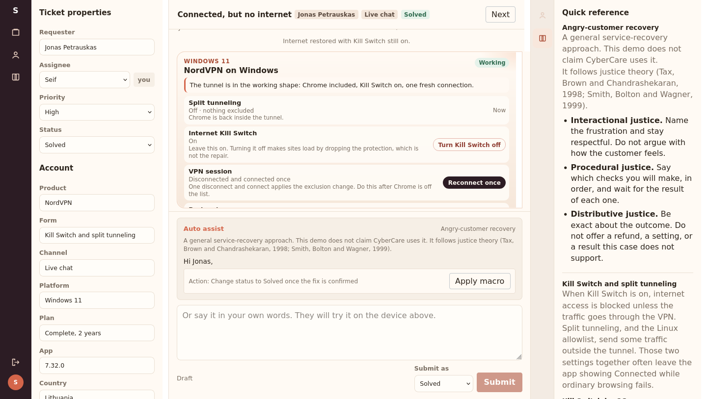

# Seif

A local customer-support desk. The agent reads the device, sends a careful reply, and waits while the customer tries that step and writes back what the screen did.

Seif is a sample project you can run on your own machine. It is a portfolio piece for hiring managers and anyone else who wants to see the work. It is not a NordVPN product, not CyberCare, and not a live helpdesk.

## For a hiring manager

You do not have to install anything to see the point of the project. Watch the short film, then read the stills under it.

**[Watch the desk: portfolio/seif-desk.mp4](portfolio/seif-desk.mp4)**

The film follows one case, Connected but no internet, from the queue to a solved ticket:

1. The customer is connected, and ordinary websites still do not load. Connected is not the same as working.
2. The device is read before anyone calls it fixed. Chrome is excluded. Internet Kill Switch stays on.
3. The reply names the frustration, then gives the checks in order, and it only promises what this case can change.
4. The customer tries it and writes the result. The case is solved only when that result matches the device.





## The five sample cases

| Case | What the customer needs |
| --- | --- |
| Connected, but no internet | Split tunneling is sending Chrome outside the tunnel while Kill Switch is on. Take Chrome off the list, leave Kill Switch on, and reconnect once. |
| Error 429 when signing in | Too many sign-in attempts. Wait 30 minutes, set the phone clock to automatic, then enter one new code. |
| Bank site will not load on VPN | The site fails only while the VPN is connected. Real-time protection is the block. Turning DNS off does not fix it. |
| Session limit reached | Quick Connect was tapped too many times. Wait 10 minutes without tapping it, then connect once. |
| Refund after renewal | The 30-day guarantee covers the first purchase only. Explain that, and cancel auto-renewal. Do not invent a refund. |

Each case is one ticket, plus the knowledge for that ticket. The sidebar and the suggested reply both come from the case that is open.

## How a reply is written

The suggested reply is built from rules, not from an open prompt.

- It greets the customer by first name.
- It names the frustration and stays respectful.
- It lists the checks in order.
- It is exact about the outcome. It does not offer a refund, a setting, or a result the case does not support.
- It is signed with the signed-in agent's name.

That shape is a general service-recovery approach, following justice theory (Tax, Brown and Chandrashekaran, 1998; Smith, Bolton and Wagner, 1999). The guide in the desk says the same thing. This project does not claim that CyberCare uses it.

A reply that only says "I have fixed it" does not close the case. The customer checks the live facts. Turning an account setting on or off does not pretend to repair a VPN fault.

If you set a model key, the customer may phrase those same facts in their own words. The rules still decide what is true. Leave the key unset, or set `CUSTOMER_AI=off`, and the customer uses the scripted lines.

## Run it

Docker is enough.

```bash
docker compose run --rm app seed
docker compose up
```

Open http://localhost:3000.

| Agent | Email | Password |
| --- | --- | --- |
| Seif | `agent@support-console.local` | `support-local` |
| Mina Kovacs | `mina@support-console.local` | `support-local` |

These are sample logins for a desk on your own computer. The sign-in page prints the same password so a visitor is not locked out. Before anyone else can reach the port, copy `.env.example` to `.env` and change `JWT_SECRET` and `SEED_AGENT_PASSWORD`. Do not commit `.env`.

Running the seed again puts the five tickets, their messages, and their drafts back to the opening state.

After a code change:

```bash
docker compose up --build
```

## Tests

From `api`, with dependencies installed:

```bash
npm test
```

The tests check that each suggested reply resolves its own case, that a bare "I have fixed it" does not, and that a model is not allowed to invent a result the case does not support.

## What is in the repository

- `frontend` is a React and TypeScript desk. There is no client-side router. The session token stays in `sessionStorage`.
- `api` is an Express service. Request bodies are checked with Zod. Errors come back as `{ error: { code, message, details } }`.
- PostgreSQL is reached through Prisma. Sign-in returns a bearer token that lasts 12 hours.
- Knowledge is not copied into the database. The scenario modules under `api/src/modules/products/nordvpn/` are the source of truth.
- The NordVPN situations are paraphrased from public help articles so the cases have a real shape. They are not official support content.

## Add a case

1. Add a scenario in `api/src/modules/products/nordvpn/scenarios.ts` with a summary, quick-reference sections, customer-facing steps, and the public article URLs.
2. Add one sample ticket in `samples.ts` with that scenario's key.
3. Rebuild, then run the seed again.

A new product is a folder under `api/src/modules/products/` with the same shape, registered in `registry.ts`. Channels and integrations are lists in `api/src/modules/channels` and `api/src/modules/integrations`. This version does not call an outside service for those integrations.
